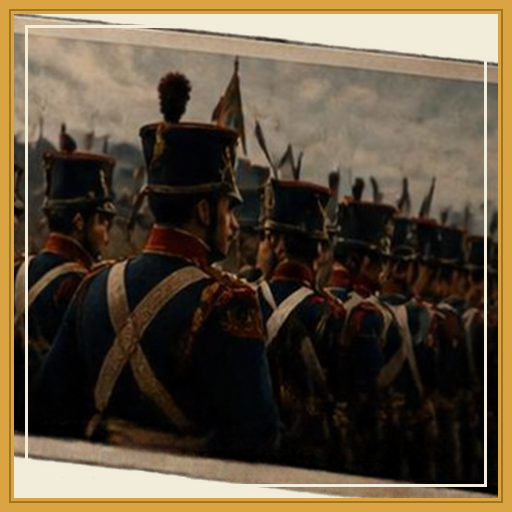
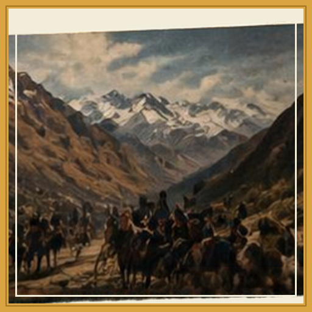
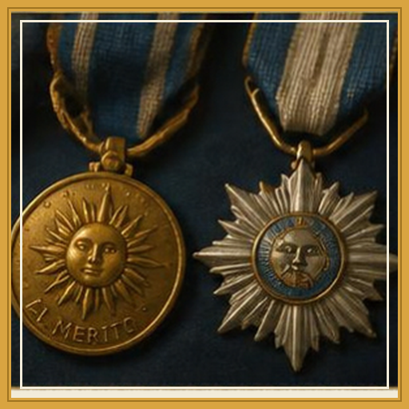

<div align="center">


# 🏔️ El Camino del Libertador


**Juego educativo sobre el Cruce de los Andes.**
Explorá el campamento, superá los retos del Ejército y asciende de Recluta a Granadero Honorario.

**[⬇️ Descargá la demo desde Releases](https://github.com/maxi2809/el-camino-del-libertador/releases/latest)**

</div>

---

## 🎮 Sobre el juego

*El Camino del Libertador* es un juego educativo inspirado en la gesta del
**Ejército de los Andes** (1817). Su núcleo sigue el loop del diseño original:

> **Explorar → Retos → Recompensas → Avanzar** … hasta llegar al **Museo del Libertador**.

Creá tu granadero (5 uniformes disponibles), viví el diálogo con el General
San Martín y demostrá tu valor logístico, histórico y de memoria a lo largo
de la campaña.

## 🕹️ Contenido de la demo

| Misión | Desafío | Recompensa |
|---|---|---|
| 🏕️ **Campamento del Plumerillo** | Atrapá los suministros que caen — 5 de cada uno (Poncho, Pólvora y Charqui) antes de que acabe el tiempo | Ascenso a **SOLDADO** |
| 📜 **Consejo del Saber** | Trivia histórica del Cruce de los Andes con datos después de cada respuesta | Ascenso a **CABO** 🎖️ |
| 🃏 **Desafío de memoria histórica** | Juego de memoria con el mosaico del arte oficial | Ascenso a **SARGENTO** |
| 🏛️ **Museo del Libertador** | Ceremonia de entrega del diploma, tu recorrido, rango y estadísticas | Reconocimiento final |

## 🎖️ Rangos

`RECLUTA` → `SOLDADO` → `CABO` → `SARGENTO` → `GRANADERO HONORARIO`

Cada ascenso se celebra con el retrato oficial del rango y su medalla.

## 🚀 Cómo jugar

1. Entrá a **[Releases](https://github.com/maxi2809/el-camino-del-libertador/releases/latest)** y descargá `El.Camino.del.Libertador.exe`.
2. Ejecutalo — **no requiere instalación**.
3. Si Windows muestra *"Windows protegió tu PC"*: clic en **Más información → Ejecutar de todas formas** (aviso normal de ejecutables sin firma).
4. Elegí tu granadero y ¡a la campaña!

## 🛠️ Desarrollo

- **Motor**: Godot 4.7 (Forward Plus / D3D12)
- **Lenguaje**: GDScript
- **Resolución**: 1280×720
- Estructura principal:

```
├── scenes/        # Escenas del juego (splash, niveles, museo…)
├── minigames/     # Minijuego de memoria
├── assets/
│   ├── gdd/       # Arte e identidad del GDD (avatares, rangos, íconos)
│   └── video/     # Videos de logro y ceremonia (OGV)
├── theme/         # Tema visual global (UI)
└── song/          # Banda sonora (proyecto REAPER)
```

Para abrir el proyecto: instalá **Godot 4.7**, abrí esta carpeta como proyecto
y presioná **F5** (▶️).

## 🖼️ Arte del juego

<div align="center">
  &nbsp;
  &nbsp;
  
</div>

## 📜 Créditos

Proyecto educativo desarrollado con el Game Design Document e identidad visual
de **Vela Studios**. Arte y música originales del proyecto.

> *"Los hombres libres de América empiezan hoy una nueva carrera..."*
> — José de San Martín, proclama del Cruce de los Andes, 1817
